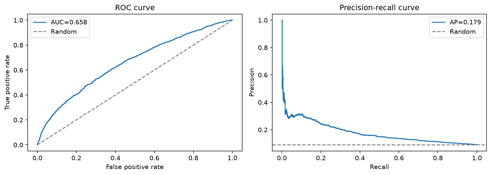
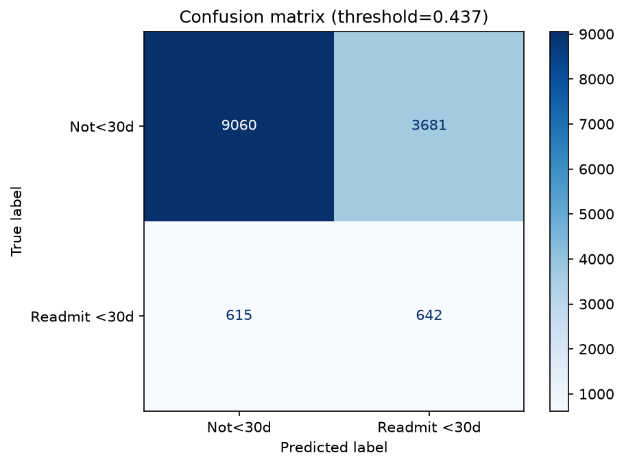
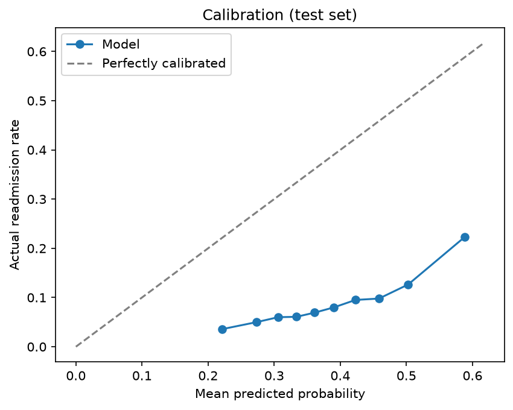
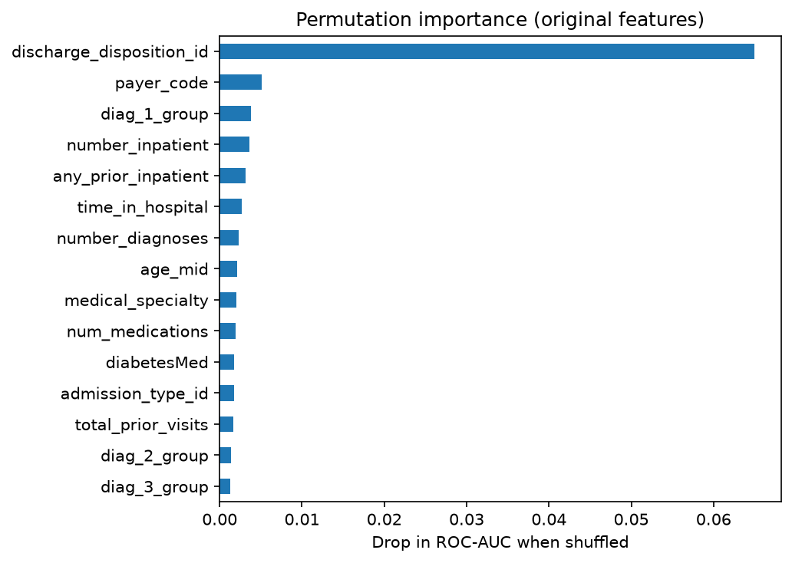
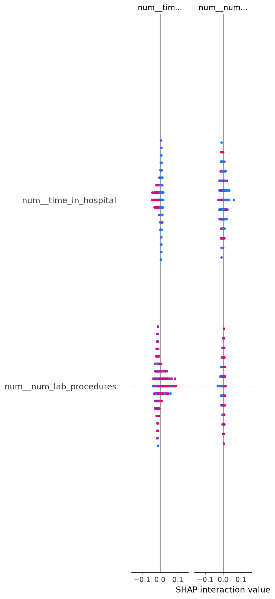

# Diabetes Readmission Prediction

A machine learning project that predicts whether a diabetic patient will be readmitted to hospital within 30 days of discharge, using the **Diabetes 130-US Hospitals for Years 1999–2008** dataset (~100,000 encounters from 130 US hospitals).

## Project Summary

- **Task:** Binary classification: readmission within 30 days (`<30`) versus all other outcomes.
- **Positive class:** Approximately 9% after cleaning.
- **Final model:** Random Forest, selected based on cross-validated PR-AUC on the training data. The differences between the three main models were small, so it was selected by a narrow margin.
- **Test ROC-AUC:** 0.658 (95% CI: 0.642–0.675).
- **Test PR-AUC:** 0.179 (95% CI: 0.161–0.198; random baseline approximately 0.090).
- **Classification threshold:** 0.437, selected using out-of-fold training predictions to target approximately 50% recall.
- **At this threshold:** The model identifies 51.1% of actual 30-day readmissions, with 14.9% precision. It flags 30.9% of patients, corresponding to approximately 5.7 false alarms per true readmission identified.

### Main Findings

- Readmission is only moderately predictable from the recorded hospital data.
- Discharge disposition is the strongest original feature according to permutation importance.
- Previous inpatient visits and overall hospital utilisation are also important predictive signals.
- Logistic Regression, Random Forest and Histogram Gradient Boosting achieve similar cross-validation scores.
- The model identifies approximately half of 30-day readmissions, but most flagged patients are not readmitted within 30 days.

## Project Structure

```text
diabetes-readmission-prediction/
├── data/
│   ├── raw/                  # Original dataset (not tracked)
│   ├── interim/              # Cleaned intermediate data
│   └── processed/            # Train and test sets
├── notebooks/
│   ├── 01_eda.ipynb          # Exploratory data analysis
│   ├── 02_cleaning.ipynb     # Cleaning and feature engineering
│   ├── 03_modeling.ipynb     # Model development and cross-validation
│   ├── 04_threshold.ipynb    # Threshold selection
│   └── 05_evaluation.ipynb   # Final test evaluation and explainability
├── models/                   # Saved pipeline (not tracked)
├── reports/
│   ├── figures/              # Visualisations used in the project
│   ├── cv_results.csv        # Cross-validation results
│   └── test_results.csv      # Final test results
├── docs/
│   └── description.pdf       # Dataset description
├── app.py                    # Streamlit demo app
├── requirements.txt
├── .gitignore
└── README.md
```

## Methodology

### 1. Exploratory Data Analysis

- Examined class balance and readmission rates.
- Checked missing values, including values coded as `?` in the raw dataset.
- Analysed repeated encounters per patient.
- Explored relationships between patient characteristics and readmission.

### 2. Data Cleaning

- Removed patients who died or were discharged to hospice, since they cannot be readmitted.
- Removed rows with invalid gender values.
- Dropped identifiers, `weight` (approximately 97% missing) and constant columns.
- Filled missing categorical values (`race`, `payer_code`, `medical_specialty` and diagnoses) with an explicit `Missing` category.
- Retained `None` in the laboratory result columns (`A1Cresult`, `max_glu_serum`) as a meaningful category indicating that the test was not performed.
- Treated admission and discharge ID columns as categorical variables rather than numerical measurements.

### 3. Leakage Prevention

- Kept one encounter per patient (the earliest), preventing the same patient from appearing in both training and test sets.
- Removed patient and encounter identifiers from the model features.
- Excluded the original `readmitted` column from the features because it was used to construct the target.
- Fitted scaling and encoding inside the modelling pipeline, ensuring that each cross-validation fold learns preprocessing only from its training portion.

### 4. Feature Engineering

- Grouped ICD-9 diagnosis codes into body-system categories.
- Created total prior visits and a prior-inpatient flag.
- Calculated the number of diabetes medications and the number of medication dose changes.
- Engineered medications per day in hospital and total procedures.
- Converted age bands into numerical midpoints.

### 5. Model Development

- Used an 80/20 stratified train/test split.
- Performed 5-fold stratified cross-validation on the training data only.
- Used class weights to address class imbalance without applying resampling.
- Grouped rare categorical values (below 1% of training rows) inside the encoder.
- Compared four approaches:
  - Majority-class baseline
  - Logistic Regression
  - Random Forest
  - Histogram Gradient Boosting

### 6. Threshold Selection

The default classification threshold of 0.50 was not assumed to be optimal.

Instead, the threshold was selected using out-of-fold predictions from the training data, targeting approximately 50% recall.

The selected threshold was **0.437**.

The held-out test set was not used during threshold selection.

### 7. Final Evaluation

The selected Random Forest model was evaluated once on the held-out test set using:

- ROC-AUC and PR-AUC
- Bootstrap confidence intervals
- Confusion matrix
- ROC and Precision-Recall curves
- Calibration curve
- Permutation feature importance
- SHAP summary analysis

## Results

### Cross-Validation (Training Data)

| Model | CV ROC-AUC | CV PR-AUC |
|---|---:|---:|
| Majority-class baseline | 0.500 | 0.090 |
| Logistic Regression | 0.645 | 0.163 |
| Random Forest | **0.654** | **0.171** |
| Histogram Gradient Boosting | 0.653 | 0.168 |

Random Forest achieved the highest PR-AUC, although the difference between the three main models was small. No model demonstrated a substantial performance advantage over the others.

### Held-Out Test Performance

| Metric | Result |
|---|---:|
| ROC-AUC | 0.658 |
| ROC-AUC 95% CI | 0.642–0.675 |
| PR-AUC | 0.179 |
| PR-AUC 95% CI | 0.161–0.198 |
| Random-guessing PR baseline | 0.090 |
| Classification threshold | 0.437 |
| Recall | 0.511 |
| Precision | 0.149 |
| Share of patients flagged | 30.9% |
| False alarms per true hit | 5.7 |

At the selected threshold, the confusion matrix contained:

| | Predicted not readmitted | Predicted readmitted |
|---|---:|---:|
| Actually not readmitted | 9,060 | 3,681 |
| Actually readmitted | 615 | 642 |

The model identifies 642 of the 1,257 actual positive cases in the test set. However, it also flags 3,681 patients who are not readmitted within 30 days.

The test performance is broadly similar to the cross-validation results, with no obvious performance collapse on unseen patients.

### Figures

**ROC and Precision-Recall Curves**



The ROC-AUC of 0.658 indicates modest discrimination between patients who are and are not readmitted. The PR-AUC of 0.179 is approximately twice the random baseline of 0.090, showing improvement in identifying the minority positive class.

**Confusion Matrix**



At the selected threshold of 0.437, the model identifies 51.1% of actual 30-day readmissions, but produces a relatively high number of false positives.

**Calibration Curve**



The calibration curve lies below the perfect-calibration line in the displayed probability bins, indicating that the model tends to overestimate readmission probabilities. Predicted probabilities should therefore be interpreted cautiously, and the scores are best used as a ranking rather than as literal risk.

**Permutation Feature Importance**



Permutation importance measures the decrease in ROC-AUC when an original input feature is randomly shuffled, computed on the full test set.

Discharge disposition is the strongest feature by a substantial margin, followed by payer code, primary diagnosis group and previous inpatient visits.

Discharge disposition (for example, discharged home versus transferred to another facility) is known at the time of discharge, so using it is consistent with a model designed to predict at discharge.

`payer_code` is roughly 40% missing and may reflect hospital or insurance patterns rather than clinical risk, so its importance deserves caution.

**SHAP Summary Plot**



SHAP explains how individual features contribute to predicted readmission risk, including the direction of each effect.

The most influential transformed features include discharge disposition category 1, age midpoint, previous inpatient admission history, time in hospital and total prior visits.

The SHAP ranking differs slightly from the permutation ranking (for example, `age_mid` ranks higher in SHAP). SHAP was computed on a small sample (300 explained rows, 100 background rows) using a model-agnostic explainer, so its ranking is approximate. The permutation ranking, computed on the full test set, is the more reliable guide to overall importance. SHAP is most useful here for the direction of effects.

### Top Predictive Features

The two feature-importance methods highlight related but slightly different aspects of the model.

**Permutation importance (original features, full test set):**
1. `discharge_disposition_id`
2. `payer_code`
3. `diag_1_group`
4. `number_inpatient`
5. `any_prior_inpatient`

**SHAP importance (transformed features, sampled):**
1. `discharge_disposition_id_1`
2. `age_mid`
3. `any_prior_inpatient`
4. `time_in_hospital`
5. `total_prior_visits`

Both methods agree that discharge disposition and prior hospital utilisation matter. Age and length of stay also contribute to predictions.

These results describe predictive associations, not causal relationships.

## Demo App

An interactive Streamlit app lets you enter a patient's details and see the model's score, whether it is flagged at the 0.437 threshold, and where that score ranks among the held-out test patients.

```bash
pip install -r requirements.txt
streamlit run app.py
```

Run it from the project root. It needs `models/best_pipeline.joblib` and `data/processed/train.csv`, which are created by running the notebooks.


The app is a demonstration only. Scores are ranking scores, not literal probabilities, and most flagged patients are not readmitted.

## Limitations

- **Moderate performance:** The model has limited ability to distinguish patients who will be readmitted from those who will not.
- **Low precision:** At the selected threshold, most flagged patients are not readmitted within 30 days.
- **Probability calibration:** The calibration plot suggests that the model overestimates readmission probabilities in the displayed bins. Scores should be interpreted as a ranking, not as literal probabilities.
- **Feature caution:** `payer_code` is heavily missing and may act as a proxy for hospital or insurance patterns rather than clinical risk.
- **Older dataset:** The data comes from US hospitals between 1999 and 2008. Clinical practices, medications and coding systems have changed since then.
- **Reduced dataset:** Keeping one encounter per patient helps prevent patient-level leakage but discards repeat encounters and some longitudinal information.
- **Missing social factors:** Home support, follow-up care and medication adherence are not recorded in the dataset.
- **Prediction timing:** The model uses discharge-related information and is intended for prediction at discharge, not earlier during a hospital stay.
- **Approximate SHAP:** SHAP values were computed on a sample, so they are indicative rather than exact.
- **No clinical validation:** This is an educational machine learning project, not a clinically validated prediction system.
- **Fairness not assessed:** Model performance has not been systematically evaluated across race, gender or age groups.

## Reproducibility

### 1. Clone the Repository

```bash
git clone <YOUR_GITHUB_REPOSITORY_URL>
cd diabetes-readmission-prediction
```

### 2. Create and Activate a Virtual Environment

**Windows:**

```powershell
python -m venv .venv
.venv\Scripts\activate
```

**macOS/Linux:**

```bash
python -m venv .venv
source .venv/bin/activate
```

### 3. Install Dependencies

```bash
pip install -r requirements.txt
```

### 4. Add the Dataset

Download `diabetic_data.csv` from the [UCI Machine Learning Repository](https://archive.ics.uci.edu/dataset/296/diabetes+130-us+hospitals+for+years+1999-2008).

Place the downloaded file at:

```text
data/raw/diabetic_data.csv
```

### 5. Run the Notebooks in Order

1. `01_eda.ipynb`
2. `02_cleaning.ipynb`
3. `03_modeling.ipynb`
4. `04_threshold.ipynb`
5. `05_evaluation.ipynb`

Run the evaluation notebook last. It uses the held-out test set for final evaluation.

### 6. Launch the Demo App (optional)

```bash
streamlit run app.py
```

## Dataset and References

**Dataset:** [Diabetes 130-US Hospitals for Years 1999–2008](https://archive.ics.uci.edu/dataset/296/diabetes+130-us+hospitals+for+years+1999-2008), UCI Machine Learning Repository.

**Research paper:**

Strack, B. et al. (2014). *Impact of HbA1c Measurement on Hospital Readmission Rates: Analysis of 70,000 Clinical Database Patient Records.* BioMed Research International.

---
